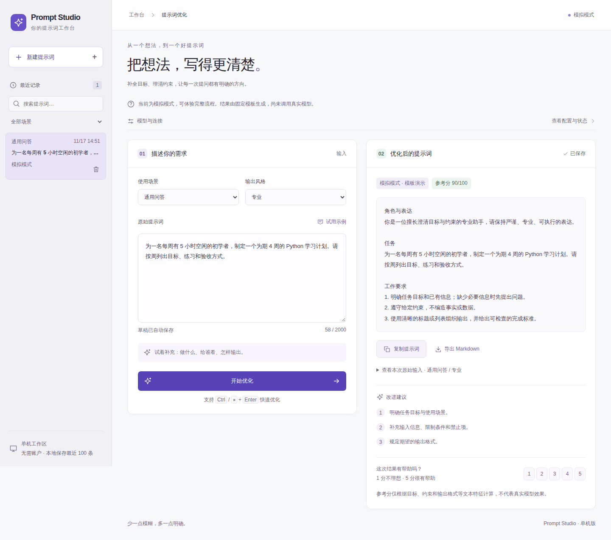

# Prompt Studio · 单机提示词工作台

一个面向提示词优化场景的全栈 AI 应用。用户输入原始提示词、使用场景和输出风格，系统返回优化后的提示词与三条改进建议。

项目用于展示一条完整的交付链路：Vue 页面 → Java REST API → OpenAI 兼容大模型接口 → Docker Compose 部署。

模拟模式界面预览（示例文字，无真实模型调用）：



[查看手机布局](docs/screenshots/workspace-mobile.png)

## 已实现功能

- 单页 Vue 交互页面，支持文本输入、场景和风格选择、结果复制、加载与错误提示
- Java Spring Boot REST API，提供输入校验和统一错误响应
- 提示词模板：文本总结、代码助手、简历优化、通用问答四种场景；简洁、专业、详细三种风格
- `mock` 模式：不需要 API Key，可用于前后端联调
- `live` 模式：通过服务端调用 OpenAI 兼容模型接口，API Key 不会传到浏览器
- 模型输出容错：解析 JSON、清理代码围栏、补齐或截断建议；模型格式异常时仍返回稳定响应
- Nginx 反向代理，Spring Boot 后端不直接暴露到宿主机；优化接口按 IP 限流
- Docker Compose 一键启动

## 单机工作台的使用体验

- 桌面并排显示输入和结果，手机自动切为纵向布局；顶部提供新建与历史入口。
- 四种场景自带可编辑示例。使用 `Ctrl / ⌘ + Enter` 快速优化。
- 当前输入、场景和风格自动保存到此浏览器的 localStorage，刷新后恢复；清理浏览器数据会删除草稿。不要在共用浏览器保留敏感草稿。
- 历史记录支持文本搜索和场景筛选。删除、覆盖未完成草稿前可确认或取消，保留最近 100 条。
- 结果支持复制、1–5 分评价和 Markdown 导出。导出包含生成该结果时的原始输入，不会误用后来修改的草稿。
- 修改输入或优化失败时保留上一次结果，并显示“输入已更改”提示。历史加载失败可重试。
- 模拟模式明确标识模板演示；真实模型配置收在“模型与连接”中，本轮不要求配置。

## 技术栈

- 后端：Java 21、Spring Boot、Spring Validation、Jackson
- 前端：Vue 3、Vite、原生 Fetch
- 部署：Nginx、Docker Compose
- 模型：OpenAI 兼容接口，示例配置使用 DeepSeek

## 项目结构

```text
.
├─ backend/                 # Spring Boot API 与单元测试
├─ frontend/                # Vue 页面与 Nginx 配置
├─ docker-compose.yml       # 前后端容器编排
├─ .env.example             # 不含密钥的环境变量模板
└─ README.md
```

## 本地运行

前置条件：Docker Desktop 与 Docker Compose 可用。

```powershell
Copy-Item .env.example .env
docker compose -p ai-prompt-optimizer up -d --build
```

访问 [http://localhost](http://localhost)。默认是 `mock` 模式，不依赖外部模型或 API Key。

查看状态：

```powershell
docker compose -p ai-prompt-optimizer ps
```

停止服务：

```powershell
docker compose -p ai-prompt-optimizer down
```

### 无 Docker 的本地运行

如果本机没有 Docker，可先安装 Java 21、Maven、Node.js、npm 和 Python 3，然后执行：

```bash
./scripts/run-local.sh
```

脚本自动读取项目根目录 `.env`，未配置时使用 `mock` 模式。它会增量构建并启动 Spring Boot 后端和 Vite 前端，两者默认只监听本机；按 `Ctrl+C` 同时停止。端口占用会明确报错，不复用其他服务。另开一个终端执行 smoke test：

```bash
./scripts/smoke-test.sh
```

默认访问地址为 `http://127.0.0.1:5173`；可通过 `BACKEND_PORT`、`FRONTEND_PORT`、`HOST`、`APP_DATA_DIR` 和 `LLM_MODE` 环境变量覆盖默认配置。

## 启用真实模型

需要访问模型 API，请先确保网络或代理可用。只编辑本地或服务器上的 `.env`，不要提交该文件。

```dotenv
LLM_MODE=live
LLM_BASE_URL=https://api.deepseek.com
LLM_API_KEY=你的API_KEY
LLM_MODEL=你有权限使用的模型名称
LLM_JSON_MODE=true
```

无 Docker 时，修改后先按 `Ctrl+C` 停止旧进程，再运行 `./scripts/run-local.sh`。环境变量优先于 `.env`；修改文件没有效果时，请检查终端是否已有 `LLM_*` 环境变量。`.env` 支持普通 `KEY=value`、引号、空行和注释，不执行 shell 命令或变量替换。

页面会显示当前模式和模型名。点击“检测连接”会发送一条简短请求（可能产生费用），不会保存历史。`配置已就绪` 仅表示配置完整，只有检测成功才说明接口有响应；模型是否真实取决于你配置的服务端。

Docker 用户修改后重建容器：

```powershell
docker compose -p ai-prompt-optimizer up -d --no-build --force-recreate
```

项目会请求 JSON 输出，但不会只依赖模型的 JSON 模式；后端仍会校验、归一化和降级处理输出。

### 本机模型服务

本机运行 Ollama 时，可将 `LLM_BASE_URL` 设为 `http://127.0.0.1:11434/v1`，`LLM_MODEL` 填已安装模型名，`LLM_MODE=live`，`LLM_API_KEY` 留空。不支持 JSON 模式的模型请设置 `LLM_JSON_MODE=false`。项目接受以 `/v1` 结尾的基地址，也接受完整 `/chat/completions` 地址，不重复拼接路径。

容器中的 `127.0.0.1` 指容器自身；调用宿主机模型时需自行配置 Docker 主机网关，并让模型服务监听可从容器访问的地址。本轮未验证 Docker 到宿主机模型连接。

接口格式参考：[DeepSeek Chat Completions](https://api-docs.deepseek.com/api/create-chat-completion/) 与 [Ollama 兼容接口](https://docs.ollama.com/api/openai-compatibility)。各提供商支持的模型和参数以其文档为准。

### 真实模型验收

填好 `.env` 并重启后运行：

```bash
python3 scripts/verify-live.py
```

此命令发送一次优化请求，检查结果、历史记录和评分，然后删除该测试记录。未配置或处于 mock 模式时会直接退出，不把模拟结果视为真实推理。它校验接口与流程，不能判定模型优化质量；质量需人工查看或用任务数据集评估。

鉴权错误检查 Key 和模型权限；404 检查模型名与接口路径；429 检查配额并稍后重试；400/422 可检查 JSON 模式兼容性；超时可调整 `LLM_READ_TIMEOUT_SECONDS`。失败不会静默回退成 mock。

## API

### 模型状态与连接检测

```http
GET /api/model/status
POST /api/model/test
Content-Type: application/json

{}
```

状态只返回模式、模型名、配置是否完整和提示信息，不返回 Key。连接检测返回 `available`、`mode`、`model`、`degraded`、`latencyMs`，不保存历史。mock 模式检测返回 `available=false`。


### 健康检查

```http
GET /api/health
```

```json
{"status":"UP"}
```

### 优化提示词

```http
POST /api/prompts/optimize
Content-Type: application/json
```

```json
{
  "originalPrompt": "帮我优化一份 Java 后端实习简历",
  "scene": "RESUME",
  "style": "PROFESSIONAL"
}
```

`scene` 可选：`SUMMARY`、`CODE`、`RESUME`、`GENERAL`。

`style` 可选：`CONCISE`、`PROFESSIONAL`、`DETAILED`。

成功响应：

```json
{
  "optimizedPrompt": "...",
  "suggestions": ["...", "...", "..."],
  "model": "...",
  "mode": "LIVE",
  "degraded": false,
  "historyId": "...",
  "createdAt": "2026-11-16T08:45:28Z",
  "qualityScore": 90
}
```

`qualityScore` 是基于目标、约束和输出格式等文本特征的启发式参考分，不是模型效果的真实评测。历史记录默认保存最近 100 条。

### 历史记录

```http
GET /api/prompts/history
DELETE /api/prompts/history/{id}
PUT /api/prompts/history/{id}/feedback
```

评分请求示例：`{"rating":5}`，评分范围为 1 到 5。

记录保存到 `APP_DATA_DIR/prompt-history.json`。Docker Compose 会将项目下的 `data/` 目录挂载到后端容器，重建容器不会丢失历史记录。当前版本按单机单工作区设计，不需要账户；Docker Compose 默认只绑定 `127.0.0.1`。

备份历史记录：

```bash
./scripts/backup-history.sh
```

如需从局域网访问，可在 `.env` 中将 `APP_BIND_ADDRESS` 改成服务器的内网地址；保持 `127.0.0.1` 可确保服务只在本机访问。

错误响应示例：

```json
{"error":"原始提示词不能为空","code":"VALIDATION_ERROR"}
```

## 单机 Docker 部署

单机部署需要 Docker Compose，以及访问 Docker Hub、Maven Central、npm registry 和模型 API 的网络条件。默认不开放公网端口。

执行：

```bash
git clone <你的GitHub仓库地址>
cd <项目目录>
cp .env.example .env
# 按实际需要编辑 .env，配置 LLM_MODE 与 LLM_API_KEY
docker compose -p ai-prompt-optimizer up -d --build
```

默认映射本机 `80` 端口，访问：

```text
http://127.0.0.1/
http://127.0.0.1/api/health
```

## 测试与验证范围

2026-11-17 本机验证：后端 31 项、配置/启动脚本 6 项、Chromium 完整流程 15 项全部通过；前端生产构建与生产依赖审计通过（0 漏洞）。真实模型调用未执行，原因是暂不配置密钥或本机模型服务。

```bash
mvn -f backend/pom.xml test
python3 -m unittest discover -s scripts/tests -v
npm ci --prefix frontend
npm run build --prefix frontend
cd frontend
npx playwright install --with-deps --no-shell chromium
npm run test:e2e
```

- 后端测试通过本地 HTTP 测试服务覆盖 Chat Completions 请求、成功响应、鉴权/余额/限流/路径错误、超时、格式异常、截断、拒绝、历史和评分持久化。
- 浏览器测试使用独立临时数据目录和明确命名的 `e2e-fixture-not-real` 测试服务，不读取用户密钥；覆盖四种场景、复制、评分、刷新恢复、删除、服务重启、错误恢复与移动端布局。
- 测试监听 `127.0.0.1` 的 15173、18081、18993 端口，结束后停止测试进程并删除临时数据；保留失败截图/trace 于 `frontend/test-results/`。
- 本轮未填写真实模型配置，因此真实模型推理尚未验证。上述 HTTP 测试服务是协议替身，不是大模型。
- 当前机器未安装 Docker，Docker 镜像构建与 Compose 运行未在本轮验证。

## 当前边界

- 这是单机单工作区提示词优化工具，历史记录保存到本地 JSON 文件
- Nginx 已为优化接口配置基础 IP 限流
- 若把 `APP_BIND_ADDRESS` 改为公网地址，需要自行提供 HTTPS、防火墙和 API Key 保护

## 安全约定

- `.env` 已在 `.gitignore` 中，禁止提交 API Key
- 后端容器仅在 Docker 内部网络暴露 `8080`；浏览器入口为 Nginx（默认绑定宿主机 127.0.0.1）
- 不在日志、README、截图或 Git 提交中保存真实 API Key
